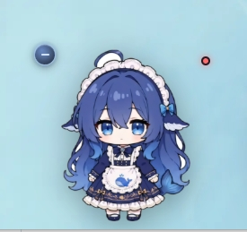
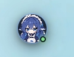
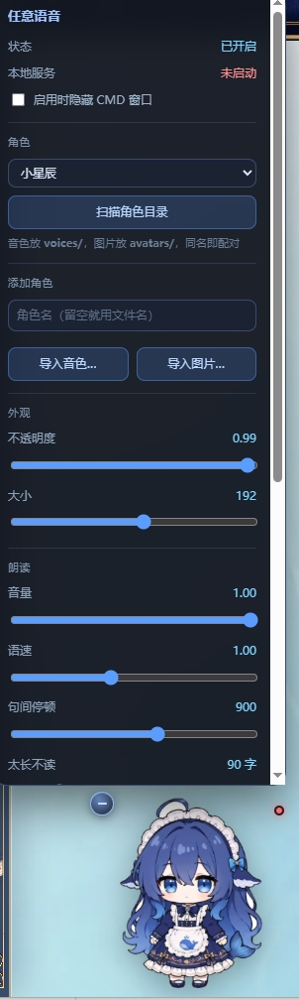

# dsh-littlestar-anything-voice · 任意语音

本插件由辰启星明与链接·1代小星辰共同制作，基于indexTTS2.5运行，可以给大肥鱼生成的文本配音，想换什么音色，只需要自己去录六到十秒的音频，然后放入voices文件夹，点击添加后选择自动添加即可。

---

## 先看效果

<p align="center">
  
  &nbsp;&nbsp;&nbsp;&nbsp;
  
</p>

左边是挂件本体：左上角那个小圆钮点一下能把立绘收起来，右上角的小圆点是状态灯（绿＝引擎在线）。
右边是收起后的样子，一枚小圆头像，点一下再展开。

▶ **[看 60 秒演示视频](docs/demo.mp4)** —— GitHub 页面里直接播放

---

## 还没有 IndexTTS 2.5？

**噢我的天呐老弟，你也太小白了吧？**（笑）

先说清楚：这个插件只是个"传话的"，真正发声的是 bilibili 的 **IndexTTS 2.5** —— 得先在你自己电脑上把它装好，插件才念得出来。不装的话挂件照常出现、角色也能加，但**点开关没有声音**。

### ① 自己动手：点下面这个链接

👉 **[https://github.com/index-tts/index-tts](https://github.com/index-tts/index-tts)**

> 这是核心团队维护的**唯一官方渠道**。其他网站、网盘、二改包都不是官方提供的，安全性和正确性没有保证。

硬要求先看一眼，不够就别硬上：**NVIDIA 显卡 + 约 6 GB 空闲显存**、**Python 3.10 或 3.11**、模型权重好几个 G。

### ② 或者：把下面这一整段复制，直接扔给你的 AI 助手

让它替你装，你只需要在最后把几个路径抄回插件面板：

```text
帮我在这台 Windows 电脑上装好 IndexTTS 2.5 的本地语音合成服务，装完我要填进一个 DSH 插件的配置里。请按顺序做，每步先确认再往下：

1. 环境检查：确认已经装了 git 和 Python 3.10 或 3.11；确认显卡是 NVIDIA、有至少 6 GB 空闲显存。缺什么先告诉我，不要擅自装驱动。

2. 挑一个剩余空间 20 GB 以上的盘建目录，然后依次执行：
   git clone https://github.com/index-tts/index-tts.git
   cd index-tts
   pip install -U uv
   uv sync --all-extras

3. 下载模型权重到项目目录下的 checkpoints（国内优先走 ModelScope，HuggingFace 直连经常超时）：
   uv tool install modelscope
   modelscope download --model IndexTeam/IndexTTS-2.5 --local_dir checkpoints
   如果 ModelScope 也不行，换 HuggingFace：
   uv tool install "huggingface-hub[cli,hf_xet]"
   hf download IndexTeam/IndexTTS-2.5 --local-dir=checkpoints

4. 试跑，确认能开界面：
   uv run webui.py --model_dir ./checkpoints --version 2.5
   浏览器打开 http://127.0.0.1:7860 能看到界面就算成功。

5. 最后报给我这四个值（我要填进插件）：
   - 项目目录：git clone 出来那个文件夹的绝对路径
   - Python 路径：一般是 <项目目录>\.venv\Scripts\python.exe
   - 启动脚本：帮我写一个能双击启动 WebUI 的 .bat，告诉我它的绝对路径
   - 服务地址：默认 http://127.0.0.1:7860

注意事项：
- 下载模型有好几个 G，请开一个可见的窗口跑，我要看到进度。
- 那个 .bat 里面不要写任何中文，包括注释。cmd 按系统编码逐行解析脚本，UTF-8 中文会把字节流撕开，报"不是内部或外部命令"。
- 别动我电脑上已有的 Python 环境和显卡驱动，尽量用 uv 隔离。
- 装的过程中如果某一步失败，先告诉我是哪一步、报的什么错，别自己换方案重来。
```

装完之后，把 AI 报给你的路径填进插件的「**引擎（IndexTTS）**」面板 —— 服务地址、项目目录、Python、启动脚本，四栏一填，点「启动服务」就通了。

---

> **当前版本：v1.12.8**
> 
> **更新内容（首个公开版本）**
>
> - 角色库改成**平铺结构**：`voices/` 放音色、`avatars/` 放立绘，**同名即配对**
> - 新增「**添加角色**」：扫描目录 / 直接导入文件；音频优先，没有图片也能用
> - 没有立绘的角色，挂件上显示一行小字：**本角色暂无图片，请添加**
> - 「**太长不读**」：本轮回答超过设定字数就整条不念（0 = 不限）
> - 设置面板会按立绘位置**自动向上/向下展开**，不会顶出屏幕
> - 状态点贴在立绘右上角；可收起成一枚小圆头像
> - 设置面板新增「**引擎（IndexTTS）**」一节：服务地址 / 项目目录 / Python / 启动脚本都能在面板里填；连不上时**直接写出缺什么**，不用翻日志
> - README 补上 IndexTTS 安装指引，以及一段可以直接丢给 AI 助手的安装指令
> - README 顶部加了效果截图和 60 秒演示视频
> 
>
> ⚠️ 本仓库**不包含任何音色和立绘**。角色库在你自己的电脑上，见「加角色」。

---

## 它做什么

一个浮在界面上的 **Q 版立绘挂件**。左键点一下 —— 它就用你指定的音色，把助手的回复念出来；再点一下闭嘴。

- **左键单击** —— 开关自动朗读（打开时顺手把本地 TTS 服务拉起来）
- **右键 / Shift+点击** —— 打开设置面板
- **拖动** —— 挪位置，位置会记住
- **左上角小圆钮** —— 收成一枚圆形头像，再点展开

合成走本地的 **IndexTTS 2.5** 声音克隆：一个角色 = 一段参考音频，谁的声音都能当角色。

---

## 安装

```bash
dsh plugin add dsh-littlestar-anything-voice
```

或者在 DSH 桌面端「设置 → 插件」里打开开关。本插件含宿主侧代码，**装完要重启 DSH**。

---

## 把路径填进插件

装好之后（怎么装见上面「还没有 IndexTTS 2.5？」），右键立绘 → 设置面板 →「**引擎（IndexTTS）**」那一节：

| 栏位 | 填什么 |
|---|---|
| 服务地址 | `http://127.0.0.1:7860`（改过端口就跟着改） |
| 项目目录 | `git clone` 下来的那个文件夹 |
| Python 路径 | 一般是 `<项目目录>\.venv\Scripts\python.exe`（可选） |
| 启动脚本 | 你自己那个 `.bat`（可选；填了才会弹出可见窗口） |

填完点「启动服务」。有**可见的 CMD 窗口**弹出来、模型加载完，面板上的「本地服务」就会变成「在线」。

> 插件不强制要它自己会启动。只要 IndexTTS 的 WebUI 开着、端口能通，手动启动也一样能用。

---

## 加角色（重点）

**一个角色 = 一段音频。** 图片是可选的。

### 目录结构

```
<DSH_HOME>/littlestar-voice/
├─ voices/            ← 音色。文件名（不含扩展名）就是角色名
│   ├─ 守岸人.mp3
│   └─ 月代雪.wav
├─ avatars/           ← 立绘。和上面同名即配对
│   ├─ 守岸人.png
│   └─ 月代雪.png
└─ config.json
```

`<DSH_HOME>` 一般是 `C:\Users\<你>\.dsh`。

**同名就配对**，就这么简单：

| voices/ | avatars/ | 结果 |
|---|---|---|
| `守岸人.mp3` | `守岸人.png` | ✅ 完整角色 |
| `守岸人.mp3` | （没有） | ✅ 能用，挂件显示「本角色暂无图片，请添加」 |
| （没有） | `守岸人.png` | ❌ 不算角色 —— **音频才是角色成立的条件** |

文件名大小写不敏感（`守岸人.MP3` 和 `守岸人.png` 也能对上）。

### 三种加法

**① 直接丢文件（最省事）**

把音频拖进 `voices/`、图片拖进 `avatars/`，两个文件同名即可。面板每 5 秒刷新一次，不用重启。

**② 面板里导入**

右键立绘 → 设置面板 → 「添加角色」：

- 先填角色名（留空就用文件名）
- 点「**导入音色…**」选音频，或「**导入图片…**」选图片
- 文件会**自动复制**到对应文件夹，不用你自己搬

**③ 扫描现状**

点「**扫描角色目录**」，会告诉你：现在有几个角色、谁缺图片、哪个图片没有对应音频（这类**不算**角色）。

### 音频怎么挑

这是能不能出好声音的关键，比图片重要得多。

- **时长 5~15 秒**。太短音色抓不住，太长没用还占地方
- **干净人声**，不要 BGM、不要混响、不要多人对话
- 格式 `wav / mp3 / flac / m4a / ogg` 都行（导入时按**文件头**认格式，不信扩展名）
- 一段话里最好有起伏，别是平的念稿

### 图片怎么挑

- **透明底 PNG** 最好，贴在浅色背景上不会有白边
- 竖图或正方形都行，**512px 以上**
- 立绘按 `object-fit: contain` 塞进正方形框，所以竖图两侧会留空

---

## 每轮怎么念

助手回完一轮，插件把这一轮的文字按句切段、逐段合成、排队播放。

### 让某一句带上情绪

在回复里写：

```
[[语音: 开心 | 今天天气真好呀]]
[[语音: 要说的话]]
```

第二种是不带情绪的原声。

可用的情绪词（**18 个**，写错会被当成正文念出来）：

> 开心 / 高兴 / 难过 / 悲伤 / 生气 / 愤怒 / 害怕 / 恐惧 / 厌恶 / 忧郁 / 低落 / 惊讶 / 惊喜 / 平静 / 害羞 / 委屈 / 撒娇 / 赌气

情绪只是叠在音色上的一层，**不换人**。拿撒娇的语气念一句责备的话，模型会折中成平平的调子，等于白加。

---

## 设置面板

<p align="center">
  
</p>

| 项 | 说明 |
|---|---|
| 角色 | 当前用谁的音色 + 立绘 |
| 不透明度 / 大小 | 挂件外观；大小 64–300 px |
| 音量 / 语速 / 句间停顿 | 播放调整 |
| **太长不读** | 本轮回答超过这个字数就整条不念。0 = 不限 |
| 情绪 | 关掉「自动按文本选情绪」才能手选 |
| 启动服务 | 手动拉起本地 TTS |

---

## 常见问题

**Q：点了没声音？**
先看面板上的「本地服务」是不是「在线」。没在线就点「启动服务」，等那个 CMD 窗口把模型加载完（第一次要几十秒）。

**Q：念出来是别人的声音 / 音色不像？**
参考音频的问题。换成 5~15 秒的干净人声重试；带 BGM 或者只有 2 秒的片段，克隆出来一定不像。

**Q：改了文件夹里的文件，插件没反应？**
面板每 5 秒拉一次状态；实在没有就点一下「扫描角色目录」，或者关掉面板重开。

**Q：为什么没有立绘？**
只要 `voices/` 里有音频就算一个角色；`avatars/` 里找不到同名图片时，挂件会显示「本角色暂无图片，请添加」——**不影响发声**。

**Q：为什么没有声音和立绘文件？**
这是设计如此。音色和立绘属于你自己的素材，不随插件分发，也**不属于开源许可覆盖的范围**。

---

## 授权须知

- 本仓库的**代码**以 MIT 发布。
- 本仓库**不附带任何音色文件、立绘图片或第三方素材**。你自己加进来的音色和图片，版权由你自己负责 —— 尤其是**真人声音克隆**，请确认你有权使用那段声音，并遵守你所在地区的相关法律。
- 声音克隆技术本身是中性的；用它冒充他人、伪造录音属于滥用，与本项目无关。
- 依赖的 IndexTTS 2.5 遵循其自身的开源协议，请一并阅读。
